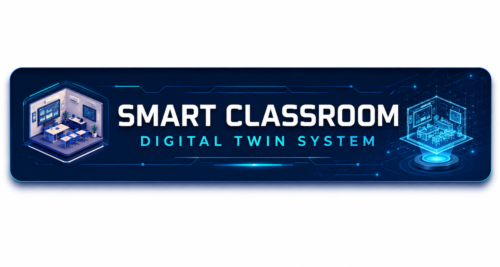

 

 

  

### ✦ ONE CLASSROOM, TWO WORLDS ✦

*Versi digital dari ruang kuliah, tanpa perangkat keras tambahan.*

 

<h2 align="center">🌐 ABOUT THE PROJECT</h2>

**Smart Classroom Digital Twin System** merupakan project pengembangan sistem yang mengangkat konsep Digital Twin dalam lingkungan pendidikan, khususnya ruang kelas perkuliahan.

Konsep ini menghubungkan dunia nyata dengan representasi digital sehingga kondisi dan aktivitas ruang kelas dapat divisualisasikan, dipantau, serta disimulasikan melalui lingkungan virtual.

| 🏫 REAL WORLD | ⇄ | 🪞 DIGITAL WORLD |
|:---:|:---:|:---:|
| Ruang kuliah | **Connection** | Model ruang virtual |
| Aktivitas pembelajaran | **Representation** | Visualisasi digital |
| Lingkungan nyata | **Simulation** | Lingkungan virtual |

<h2 align="center">⚡ PROJECT HIGHLIGHTS</h2>

|  |  |  |
|:---:|:---:|:---:|
| **Smart Learning** | **Digital Twin** | **Virtual Environment** |
| Konsep kelas pintar | Representasi digital | Lingkungan virtual |

 

<h2 align="center">🎯 PROJECT OBJECTIVES</h2>

Project ini dikembangkan dengan beberapa tujuan:

- 🏫 Menghadirkan representasi digital dari ruang kelas.
- 🌐 Menghubungkan konsep dunia nyata dengan dunia virtual.
- 📊 Memvisualisasikan kondisi lingkungan ruang kelas.
- 💡 Menerapkan konsep Digital Twin dalam bidang pendidikan.
- 🚀 Mengembangkan pemahaman mengenai teknologi pendidikan berbasis digital.

<h2 align="center">🔄 SYSTEM DEVELOPMENT</h2>

### SOFTWARE DEVELOPMENT LIFE CYCLE

  

  

<h2 align="center">👨‍💻 DEVELOPMENT TEAM</h2>

### ✦ MEET OUR TEAM ✦

*Different personalities, one destination.*

| PLAYER | TEAM MEMBER | ROLE |
|:---:|---|:---:|
| 🎀 01 | **Nazua** | Team Member |
| 🌸 02 | **Grace Anastasya Siahaan** | Team Member |
| ⚡ 03 | **Maulana Yoga Syahputra** | Team Member |
| 🎮 04 | **Muhammad Agil Ramadhan** | Team Member |
| 🚀 05 | **Al Ichsan Irawadi** | Team Member |

<h2 align="center">🛠️ TOOLS & TECHNOLOGIES</h2>

  

  

<h2 align="center">🎓 ACADEMIC INFORMATION</h2>

  

**Dosen Pengampu**

Cut Alna Fadhilla, S.Kom., M.Sc.

 

**Mata Kuliah**

Rekayasa Perangkat Lunak

 

**Program Studi**

Informatika

<h2 align="center">🌌 OUR VISION</h2>

 

  

*Connecting real education with digital innovation.*

 

