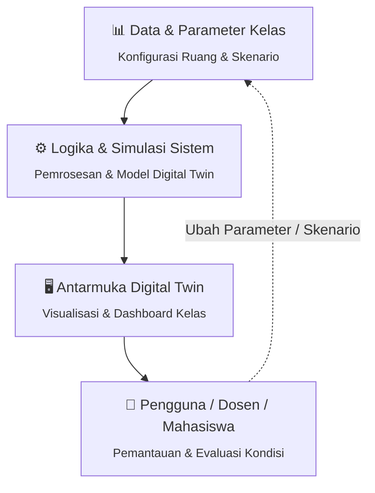

 

---

## 📌 Ringkasan Proyek

**Smart Classroom Digital Twin System** adalah representasi digital dari ruang kelas yang dirancang untuk membantu pemantauan, simulasi, dan pengelolaan kondisi lingkungan belajar **tanpa memerlukan pemasangan perangkat keras tambahan** di dalam ruangan.

Fokus utama proyek ini adalah menghadirkan visualisasi ruang kelas yang informatif, ringan diimplementasikan, serta mudah dikembangkan secara bertahap sesuai siklus pengembangan perangkat lunak.

---

## 🎯 Latar Belakang & Masalah

* Pengelolaan dan pemantauan kondisi ruang kelas sering kali masih dilakukan secara manual atau bergantung pada perangkat IoT/sensor fisik yang membutuhkan biaya instalasi dan perawatan tambahan.
* Informasi terkait tata letak, pemanfaatan ruang, serta kondisi simulasi kelas belum terpusat dalam satu tampilan digital yang mudah diakses.
* Diperlukan model *digital twin* berbasis perangkat lunak yang dapat merepresentasikan ruang kelas secara terstruktur dan terukur sejak tahap perencanaan.

---

## 🚀 Tujuan Proyek

* Membangun prototipe **Smart Classroom Digital Twin System** yang berfungsi sebagai replika digital ruang kelas.
* Menyediakan antarmuka visual untuk memantau dan mensimulasikan kondisi ruang kelas secara terstruktur.
* Menerapkan alur kerja **Rekayasa Perangkat Lunak** yang rapi—mulai dari perencanaan, analisis kebutuhan, perancangan, implementasi, pengujian, hingga rilis.

---

## ✨ Rencana Fitur Utama

| Fitur | Deskripsi Singkat | Prioritas |
|:------|:------------------|:---------:|
| **Representasi Ruang Digital** | Visualisasi tata letak dan elemen ruang kelas dalam format digital | Tinggi |
| **Simulasi & Skenario Kelas** | Pengujian kondisi atau pengaturan ruang tanpa perangkat keras fisik | Tinggi |
| **Dashboard Informasi** | Ringkasan status dan data utama ruang kelas agar mudah dibaca | Sedang |
| **Manajemen Data Konfigurasi** | Penyimpanan dan pembaruan parameter ruang kelas secara terstruktur | Sedang |

---

## 🧱 Arsitektur Tingkat Tinggi (Gambaran Awal)

---

## 🛠️ Teknologi yang Digunakan

---

## 🗓️ Target Tahapan

* **Sprint 1 (Saat Ini):** Penyusunan profil tim, profil proyek, *project charter*, analisis kebutuhan awal, dan rancangan konsep sistem.
* **Sprint Berikutnya:** Pengembangan komponen inti, integrasi data simulasi, pengujian fungsionalitas, dan penyempurnaan antarmuka.

---

Dokumen ini dikelola oleh <b>Kelompok 3</b> • Mata Kuliah Rekayasa Perangkat Lunak

