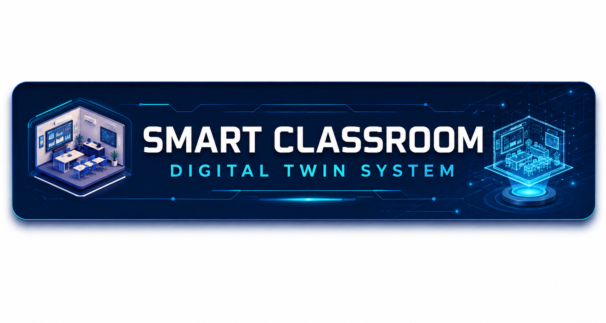

---

## 📌 1. Identitas Proyek

| Atribut | Detail |
|:--------|:-------|
| **Nama Proyek** | Smart Classroom Digital Twin System |
| **Tim Pelaksana** | Kelompok 3 (Rekayasa Perangkat Lunak) |
| **Tahap Saat Ini** | Sprint 1 |
| **Tagline / Misi** | *Versi digital dari ruang kuliah, tanpa perangkat keras tambahan.* |

---

## 🎯 2. Tujuan & Latar Belakang

* **Latar Belakang:** Pemantauan dan simulasi kondisi ruang kelas sering kali bergantung pada proses manual atau perangkat keras tambahan yang membutuhkan biaya serta instalasi lebih.
* **Tujuan Proyek:** Merancang dan membangun sistem *digital twin* ruang kelas yang informatif, terstruktur, dan dapat dikembangkan bertahap melalui alur Rekayasa Perangkat Lunak.

---

## 🧭 3. Ruang Lingkup (Scope)

### Termasuk Cakupan (In-Scope)
* Penyusunan dokumen perencanaan awal (*profil kelompok*, *profil proyek*, dan *project charter*).
* Representasi dan simulasi kondisi/parameter ruang kelas dalam bentuk digital.
* Tampilan informasi/dashboard yang mudah dipahami pengguna.

### Di Luar Cakupan (Out-of-Scope)
* Pembelian, perakitan, atau instalasi sensor/perangkat keras fisik di ruang kelas.
* Fitur komersial berskala produksi penuh di luar kebutuhan mata kuliah.

---

## 👥 4. Tim & Pembagian Peran

| Anggota | Username GitHub | Branch | Peran / Tanggung Jawab Awal |
|:--------|:----------------|:-------|:-----------------------------|
| **Nazua** | `@nazua4868-coder` | `nazua` | *Isi peran / tanggung jawab* |
| **Grace Anastasya Siahaan** | `@geyesanastasya05-hub` | `grace` | *Isi peran / tanggung jawab* |
| **Maulana Yoga Syahputra** | `@Nganggurr` | `yoga` | *Isi peran / tanggung jawab* |
| **Muhammad Agil Ramadhan** | `@agilramadhannn` | `agil` | *Isi peran / tanggung jawab* |
| **Al Ichsan Irawadi** | `@al-ichsan` | `ichsan` | *Isi peran / tanggung jawab* |

> **Aturan Kerja Git:** Setiap anggota mengerjakan tugas di branch masing-masing, melakukan commit secara berkala dengan pesan jelas, lalu menggabungkan ke `main` setelah disepakati bersama.

---

## 🗓️ 5. Tahapan & Target Milestone

* **Sprint 1:** Penetapan charter proyek, profil tim & proyek, analisis kebutuhan awal, serta rancangan alur/arsitektur sistem.
* **Sprint Berikutnya:** Pengembangan fitur inti, pengujian (*testing*), perbaikan bug, dan penyempurnaan dokumentasi rilis.

---

## ⚠️ 6. Risiko Awal & Mitigasi

| Risiko | Dampak | Mitigasi |
|:-------|:-------|:---------|
| **Konflik saat *merge* branch** | Perubahan kode tertimpa atau error | Selalu `pull` / update branch sebelum *merge* dan koordinasi di grup |
| **Cakupan fitur terlalu luas** | Target sprint molor | Fokus pada fitur inti terlebih dahulu sesuai prioritas |
| **Keterlambatan update progres** | Koordinasi tim terhambat | Cek progres rutin dan komunikasi terbuka antar anggota |

---

## ✅ 7. Kriteria Keberhasilan

* Seluruh dokumen utama Sprint 1 tersusun rapi dan ter-commit di repository GitHub.
* Tujuan, batasan ruang lingkup, dan alur kerja tim disepakati bersama oleh seluruh anggota.
* Sistem/prototipe berjalan sesuai alur yang direncanakan pada masing-masing tahap sprint.

---

Disusun oleh <b>Kelompok 3</b> • Dokumen Kesepakatan Proyek

